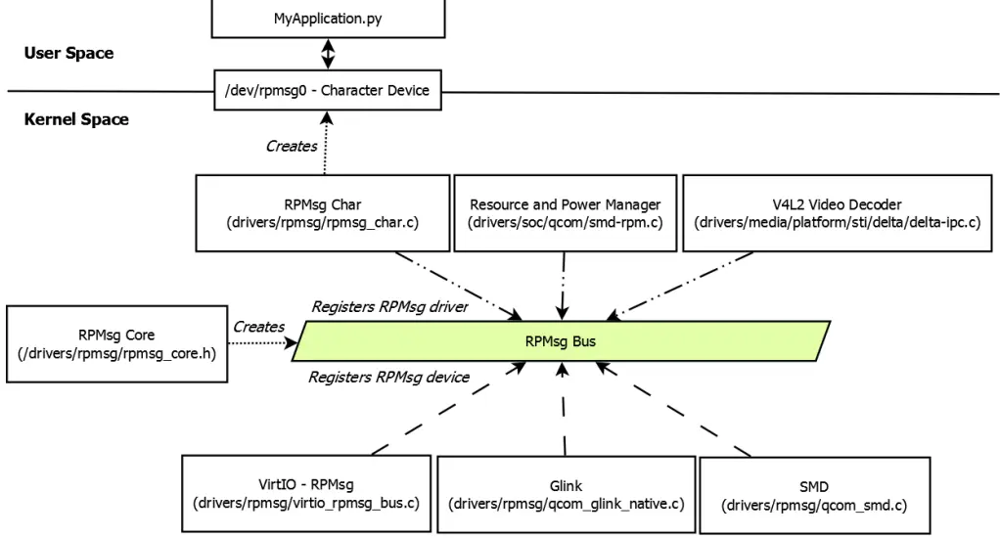
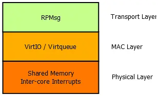
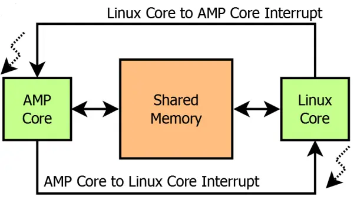
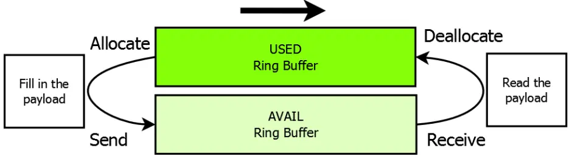

RPMsg, 全称Remote Processor Messaging, 它定义了异构多核处理系统中核与核之间进行通信所使用的二进制接口。

### AMP
现代的芯片架构十分复杂，通常都包含多个核心。特别是SoC, 一颗芯片上不仅包含了多个核心，核心之间的架构可能都是不同的。比如手机中，就包含了CPU, GPU, NPU, DSP等多种不同的处理单元，用于处理图像声音，端侧推理等目的。总而言之，他们都有各自的功能存在，我们不能等同地对待他们。

为了最大限度地发挥各自的性能，不同的模块可能搭载了完全不同的系统，比如同时搭载Linux和RTOS，一个是为了处理多媒介的请求，一个是为了处理传感器数据等需要高实时性的场景。这些不同架构的核心以及他们上面所搭载的软件组合在一起，就组成了一个AMP系统。不同异构模块之间的通信主要是通过(Inter-Process Communication)协议进行通信，而RPMsg就是IPC的一种。有一些IPC协议依赖TCP/IP网络栈实现，但是并不是所有SoC都会默认搭载网络栈。而RPMsg就是一种不依赖网络的IPC通信方式。

### RPMsg
##### Linux下的RPMsg
在Linux内核代码中，RPMsg的代码主要位于drivers/rpmsg/下，代码之间的关系如下图所示：

整个RPMsg协议会在devfs文件系统下暴露一个字符设备接口，用户空间的脚本就可以通过这个接口发送消息给到接收端。在Linux内核早期阶段，只提供了VirtIO作为协议的传输层，后面则又提供了其他平台的专用方式，如高通平台的Glink和SMD.

#### 原理
首先我们需要知道，当我们说RPMsg协议的时候，我们其实说的是一个传输层的协议。所谓传输层协议，就是负责定义数据的格式。收发双方根据预先定义的格式来获得自己的payload, 以及做一些控制功能。

定义了格式，我们还需要有一个实际的数据链路来传输这些数据包。如我们上面讲的，一开始是采用VirtIO作为默认方式，后面才引入了一些其他的方式。

有了数据链路后，我们还需要实际的物理链路来真正地传递数据包。这一层的主流方案都是共享内存+核间中断。说到这里，数据链路和物理链路的区别其实有一些微妙。对于这个问题，我们可以这么理解：数据链路我们可以理解为格式化物理链路的一个过程。比如对于共享内存这个物理链路，不同的数据链路可以采用不同的格式化方式，比如按照不同的策略去划分共享内存的收发区，用不同的控制字来规划这片共享内存的通信方式等等。

物理链路提供了基础设施，数据链路是建立在物理链路基础上的一种传输策略。传输层则是格式化了数据本身。

下图就清晰地展示了RPMsg在整个AMP系统中的地位。可以看到，它属于传输层协议。
、

这里，我们以VirtIO为例，讲解其数据链路层的原理，也就是VirtIO是怎么被作为RPMsg的基础设施所使用的。在AMP下，主核和从核用共享内存+核间中断的方式进行通信，如下图所示：

在VirtIO协议下，这块区域被划分为了三个部分，分别是：
-  Descriptor table, 也就是描述符表
-  used ring
-  available ring

avail和used ring中存放的都是descriptor table中entry的索引，entry中就包含了buffer的地址，buffer中存放的才是收发双方真正的payload.

收发双方(主核和从核)通过VirtIO协议来传输RPMsg的数据包：

一般而言，在VirtIO体系下，RPMsg协议下，Linux等MPU一般是guest, 而RTOS等非MPU一般被视作host。 这个身份的划分比较重要，因为这决定了它们对于used ring和available ring的访问权限。我们知道，avail和used都是站在驱动(guest)视角的名词：
-  avail：这部分对于guest来说可写
-  used：这部分表示被设备used, guest从这里回收结果

在明确了双方的身份后，他们之间的通信过程也就比较清楚了：
##### Linux发，RTOS收
