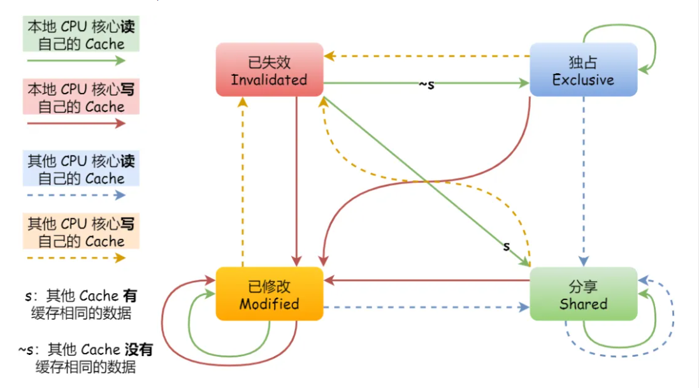

在现代CPU中，每个核心通常都有自己的私有`L1`, `L2`缓存，用于加速内存`I/O`. 然而，现代CPU通常都有多个核心，某个核心可能在某个时间点更改了内存的内容，而这部分内容所处的缓存行恰好被另外一个核心所缓存。如果不做同步协议或通知，就会导致另外一个核心中的缓存存放着旧的缓存行数据，造成内存安全。比如考虑以下的简单场景：
-  CPU 核心 A 和核心 B 都缓存了变量 `x = 0`。
-  核心 A 执行 `x = 1`，只修改了自己缓存中的 `x`。
-  如果主存或核心 B 的缓存没有更新，那么核心 B 之后读到 `x` 仍然是 `0`。

缓存一致性协议就是为了解决这个问题而诞生的。并且，不同于TLB缓存需要依赖软件来做，缓存一致性协议是硬件实现的，软件层面对此是不知情的，或者说不必关心的。

这个协议通常需要满足以下要求：
-  某个核心对缓存行的修改，必须对其他核心可见
-  对同一个地址的写操作，在所有核心看来，顺序必须是一致的
-  多个核心不会同时使用过期的数据
上面所说的对缓存行的修改，指的都是对自己私有缓存的修改，而不是内存的修改。也就是说，修改后的一段时间，缓存内容和内存的内容是不一致的，缓存一致性协议确保的是核心的缓存的同步，而不是内存和缓存的同步。当然，最后肯定是会在某个恰当的时机执行write-back的。

现在已经有比较多的成熟的缓存一致性协议方案，比如MESI, MSI, MOSI, Synapse, Firefly, DragonProtocol等。下面，我们以MESI为例子，展开对缓存一致性协议的讲解。


### 状态定义

MESI协议中，缓存行有四种状态，用2bits表示：

| 状态   | 描述                                         | 监听任务                                     |
| ---- | ------------------------------------------ | ---------------------------------------- |
| E 独享 | 该Cache line有效，数据被修改，和内存数据一致，数据只存在本Cache中   | 必须监听所有试图读该缓存行的操作，操作必须在该缓存行写回主存并将状态变为S后执行 |
| M 修改 | 该Cache line有效，数据被修改，和内存数据不一致，数据只存在本Cache中  | 必须监听所有试图读该缓存行的操作，操作必须在该缓存行写回主存并将状态变为S后执行 |
| S 共享 | 该Cache line有效，数据和内存数据一致，数据存在多个Cache中(至少一个) | 必须监听其它缓存使该缓存无效或独享该缓存的请求，并将该缓存行变为无效       |
| I 失效 | 该Cache line无效                              | 无                                        |

描述一栏描述了这个状态的含义，监听任务则表示了总线对于处在这个状态下的缓存行，需要做什么任务，来保证整个一致性协议的运行。下图给出了MESI协议的状态机：


### M/E/S/I只是稳定状态

常见的MESI状态图很容易给人一种错觉：一次状态转移好像是瞬间完成的。例如，某个核心原来持有`S`，现在准备写入，于是图上直接画成：

```text
S -> M
```

但在真实的多核系统中，这个转换通常包含一整个一致性事务。发起写入的核心要请求所有权，其他持有`S`副本的核心要处理失效请求并返回ACK，发起者收齐必要的ACK后才能确定自己已经独占这条cache line。

因此，M/E/S/I更准确地说是四种**稳定状态（stable state）**。事务尚未完成时，硬件内部还需要一些**瞬态状态（transient state）**。这些状态的名字不是MESI统一规定的，不同协议和处理器实现会采用不同命名；常见写法之一是：

```text
SM = 原来是S，正在申请M，还在等待数据或失效ACK
IM = 原来是I，正在申请M
IS = 原来是I，正在申请S
```

瞬态状态不是第五种稳定权限，而是在说：

> 这条cache line正在进行一个尚未完成的一致性事务，现在不能再按普通的M/E/S/I规则处理新请求。

#### 一个尚未完成的`S -> M`

假设最开始有三个共享者：

```text
Core 0: S
Core 1: S
Core 2: S
Core 3: I
```

Core 0准备写入，于是发起`GetM`或`BusUpgr`，要求其他共享者丢弃副本：

```text
Core 0: S -> SM

Core 1: S -> I，已经返回ACK
Core 2: S，失效请求还没有处理完
Core 3: I
```

此时Core 0还不能进入稳定的`M`。它只知道自己正在取得所有权，但Core 2仍可能持有有效的共享副本。

就在这个窗口里，Core 3又对同一条cache line发起读取：

```text
Core 3: I --GetS/BusRd--> ?
```

这个`GetS`不能脱离正在进行的升级事务，直接让Core 3进入`S`。在目录协议中，home或directory此时可能记录着：

```text
Line X:
    upgrade in progress
    requester = Core 0
    waiting ACK from Core 2
```

一种常见处理方式是先挡住Core 3的请求：

```text
GetS到达directory
        |
        v
发现Line X处于瞬态
        |
        +-- 暂存在pending queue
        +-- 返回NACK，让Core 3稍后重试
        `-- 由协议采用的其他方式延后或合并请求
```

具体采用queue、NACK、retry还是forward，取决于协议实现；不变的是，新请求必须进入同一套状态机，不能绕过正在发生的所有权转移。

假设directory选择先完成Core 0的升级，后续状态是：

```text
Core 2处理Invalidate
        |
        v
Core 2: S -> I，并返回ACK
        |
        v
Core 0收齐ACK
        |
        v
Core 0: SM -> M
```

现在再处理Core 3的读取。因为最新数据已经由Core 0以`M`状态持有，Core 0需要提供这份数据并降级，Core 3取得共享副本：

```text
Core 0: M -> S
Core 3: I -> S
```

最终状态为：

```text
Core 0: S
Core 1: I
Core 2: I
Core 3: S
```

把整个过程放在一条时间线上看会更清楚：

```text
Core 0          Directory          Core 2          Core 3

  S
  |---- GetM ------>|
  v                 |---- Invalidate --> S
 SM                 |                    | 尚未处理
  |                 |<------------- GetS ------------|
  |                 |    暂存请求或返回NACK           |
  |                 |                    |
  |                 |<------ ACK --------I
  |<--- GrantM -----|
  v
  M
  |<-- Forward GetS-|
  |----------------------- data --------------------->|
  v                                                   v
  S                                                   S
```

#### 为什么新请求不能直接穿过去

Core 0最初发出的失效请求只面向当时已经存在的共享者，也就是Core 1和Core 2。假如Core 3可以在升级期间不受约束地取得`S`，就可能出现：

```text
Core 1、Core 2都完成失效
        |
        v
Core 0收齐原定的ACK并进入M

但与此同时：
Core 3已经偷偷进入S
```

最后就会形成非法组合：

```text
Core 0: M
Core 3: S
```

`M`表示本核心拥有唯一且可能已经脏掉的最新副本，它不允许另一个核心同时保留`S`。所以，一旦某条cache line正在转移所有权，随后到达的`GetS`、`GetM`等请求都必须和当前事务排出一致的先后顺序。

这里说的顺序是**针对同一条cache line的一致性顺序**。它要求所有参与者对这条line上的事务先后达成一致，并不意味着系统中所有地址上的内存操作都存在一个总顺序；后一个问题属于[内存一致性模型](/操作系统/2026/09/22/内存一致性模型/)讨论的范围。

#### 总线协议和目录协议怎样完成排序

目录协议会在home节点为cache line保存busy、pending write、等待ACK等瞬态信息，新请求到达时由directory决定排队、拒绝、重试、转发或合并。

经典的snooping bus则天然提供了一个序列化点。假设总线仲裁结果是：

```text
Bus transaction #100: Core 0 BusUpgr(X)
Bus transaction #101: Core 3 BusRd(X)
```

所有监听者都按这个顺序观察事务，`#101`不能越过`#100`。于是系统先完成Core 0的所有权请求，再处理Core 3的读取；从状态上看，仍然是Core 0先进入`M`，随后因`BusRd`降到`S`，Core 3也进入`S`。

因此，完整的MESI实现实际上包含两层东西：

```text
                 MESI一致性协议
                       |
          +------------+-------------+
          |                          |
          v                          v
      稳定状态                 并发事务的推进
      M/E/S/I              瞬态状态 + 请求排序
```

四个稳定状态描述“现在拥有什么权限”，瞬态状态和事务排序则回答“多个请求同时到来时，怎样安全地走到下一个稳定状态”。后者才是MESI能够在真实并发环境中成立的关键。

上面的状态转移信息量很大，不过我们需要知道的是几个比较关键的点，下面一一讲解。
#### Modified始终表示最新的版本，并且同一时刻只有一个M

考虑某个缓存行，初始状态下处于Shared状态。此时：
##### 某个核心发起了写请求，修改了这个缓存行
根据状态机，该核心对于这个缓存行的状态为记录为Modified， 而其他核心对于这个缓存行的状态则会记录为Invalidated. 我们记这个发起修改请求的核心为A. 注：修改一般只会发生在缓存中，而不会马上对内存执行回写。
##### A核心继续发起修改请求
根据状态机，Modified状态下发起对自己的写请求，依旧是Modified. 而Invalidated状态下则继续是Invalidated.
##### 核心B发起了修改请求
根据状态机，我们站在A的视角，B就是Invalidated, 并且这个请求属于"其他CPU核心写自己的Cache"。 此时，A的状态就变成了Invalidated, 同时，其他那些看戏的核心依旧是Invalidated. 回到B的视角，这个请求属于“本地CPU核心写自己的Cache”，根据状态机，B的缓存行就变成了Modified.

##### 更多的写请求
根据前面的推导我们可以知道，对于Modified那个核心自身发起的写请求，对整个系统而言不会带来变化，Modified依旧Modified, Invalidated依旧Invalidated. 但是，如果是轮流的写请求，那么Modified就会轮流变化，其他核心随之变成Invalidated.

总而言之，Modified始终代表了某个缓存行的最新版本，并且对于同一个缓存行对应的内存区间，同一时刻下，只有一个核心的缓存行被记录为Modified.

#### Invalidated到Shared的变化会触发一次内存回写

根据状态机，在Invalidated的情况下，发起对本地缓存的读请求，如果不做任何处理，此时就会读取到错误的状态，因此这里是肯定会发生同步操作的。根据状态机的描述，此时缓存行的状态会从Invalidated变成Shared(不考虑独占状态)， 并且Modified也会变成Shared. 而根据Shared状态的定义，该缓存行有效，并且**和内存中的数据一致**。 也就是说，从Invalidated到Shared， 一定发生了一次内存回写。真正的时序可能是这样的：
-  Invalidated的那个核心发起了对本地的读请求
-  缓存总线发现其发起了对Invalidated的读取请求
-  此时会先触发一次内存回写，Modified中的内容被回写到内存中
-  然后Invalidated从内存获取最新的值
-  最后都更新为Shared


前面我们提到，Invalidated到Shared的变化，在MESI下，一定会触发一次内存回写。这个问题会带来严重的性能瓶颈。在现代操作系统中，有一个所谓**缓存行乒乓**问题，又叫做**一致性缺失**问题。这个问题是这样的：
-  内存中的某些区域，存在被高频访问，特别是高频修改的可能。比如说，执行流下被锁保护的一个比较热的资源。不同核心为了访问资源会频繁抢占锁，造成锁所在的缓存行被频繁读写，成为热点。
-  对锁的频繁获取和释放就会一直修改那个内存地址的内容。每次有一个核心获取锁，其他核心再次试图获取锁时，就相当于Invalidated对本地缓存发起了读请求。根据MESI协议，这就会触发一次内存的回写。也就是说，以某个核心成功获取锁为起始，释放锁结束，每第一次获取锁失败，都会触发一次内存回写。这对于热点路径来说，频率很高，总线会被同步流量和内存回写频繁占据，造成性能下降。


为了解决这个问题，ARM针对MESI协议提出了一个改进的方案，称作OMESI协议。这个协议相比较MESI变化不大，主要新增了O状态，以及微调了S状态的定义，M, E, I状态的定义保持不变。
-  O位：当前缓存行中的数据为最新的副本，并且必须至少有一个核心也缓存了同样的缓存行。在这些缓存了一样的缓存行的核心中，**只有一个的状态为O，其他的状态都为S**. 状态为O的数据和内存的数据不必一致，并且S和O对应的缓存数据也不一致。O状态对应的核心负责write-back.
-  S位： 在MESI协议中，关于S位的表述最重要的一点就是**和内存内容一致**。 也正是这一点，导致 了我们说的频繁内存回写。因此，在MOESI下，S位不再强调**和内存内容一致**，而只是表示当前缓存行是有效的，并且存在其他核心也缓存了这个缓存行。

在MOESI下，原本MESI会引发内存回写的场景，现在就变成了这个过程：
-   核心A的缓存行为M, 核心B的缓存行为I, 内存中的为旧值
-   核心B发起读请求。在MESI下，会触发A的内存回写，然后大家都变S
-   现在，A不执行回写，而是直接把最新数据发送到核心B, 然后自己的状态变为O
-   B收到数据后，把自己的状态设为S(数据是最新的，但是并不和内存保持一致)
-   在O状态下，如果需要再次修改数据，核心A会广播失效请求，让其他核心的缓存行变为I, 自己     则变为M, 然后回到上述流程的第一步
-   在A的缓存行要被换出后，才把这个数据write-back, 同时变为I

可以看到，现在内存回写被推迟到A的缓存行被换出后，大大降低了I/O次数。
