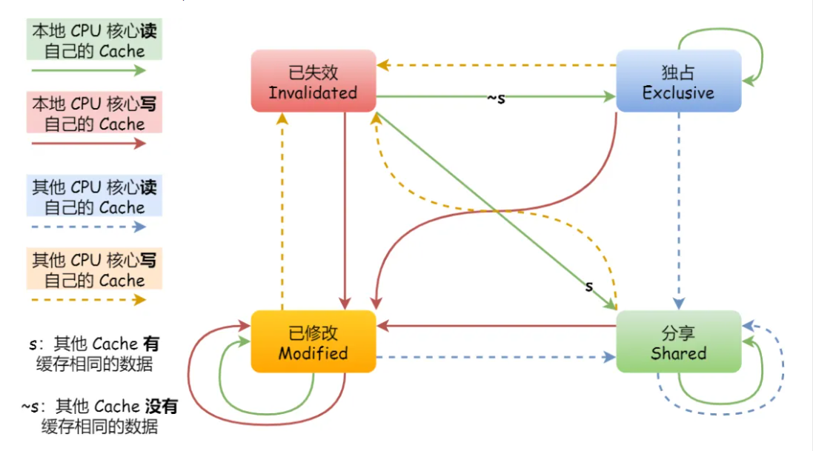

在需要同步的场景中，原子变量和锁是两个经常出现的角色， 他们通常出现在不同的场景下，承担同步的角色。那么，他们之间的关系是什么？什么时候需要用到原子变量，什么时候需要用到锁？


### 原子变量的定义

原子变量是一种特殊的变量类型，表示针对这个变量的操作，如读，写，加减，交换等，在并发环境中**表现为**不可分割的单个操作。这意味着，当一个线程正在执行对原子变量的操作时，其他线程不可能观察到该操作执行到一半的中间状态，也不会发生数据竞争。比如对于下面的代码：
```cpp
std::atomic<int> count{0};
count.fetch_add(1);   // 原子操作
```

这里的 `fetch_add(1)` 等效于“读取、加1、写回”三个步骤，但对外表现为一步，不会被其他线程从中间插入。

### 原子变量的实现

这一节，我们讲一讲原子变量的底层实现。
#### 原子窗口的实现——缓存一致性协议

原子变量的底层主要是通过缓存一致性来实现。在MESI协议中，我们有这样的一个状态转移关系：


原子变量就是依靠缓存一致性协议来保证整个操作窗口的原子性的。下面，我们针对`count.fetch_add(1)`这个例子，来讲解一下MESI是怎么帮助原子变量完成目标的。假设`count.fetch_add(1)`在`core 0`执行。并且，我们假设其他核心也有相同的缓存行缓存在自己的本地核心。整个过程是这样子的：
-  `core 0`把自己的缓存行变成`M`状态，并且，会通过`RFO`机制强制其他核心的缓存行状态为`I`.
-  加`Cache lock`锁，暂时屏蔽掉其他核心的读请求。这一步是十分关键的，我们知道，在普通的`MESI`协议下，其他核心的读请求，会让自己从`M`变成`S`, 对方也变成`S`. 而我们是原子操作，我们不希望其他核心会读到我们的中间状态，这样子本身就违反了原子性的定义。因此，这里会加一个缓存锁，暂时屏蔽其他核心的读请求。这样子，自己在完成修改之前一直是`M`, 其他核心一直是`I`。
-  在上锁期间，其他核心读不到我们的中间状态，也无法发起修改。`core 0`在窗口期间完成`读-修改-写回(不是直接写回内存，而只是写自己的缓存)`的原子窗口后，释放缓存锁。
-  锁释放后，就回到了普通的`MESI`场景，大家该读读，该写写。

可以看到，就是通过一个缓存锁，巧妙地利用缓存一致性协议来达到原子变量的目的。如果有多个不相关的原子变量被放在了同一个缓存行下，就会出现`false sharing`， 大大降低性能。因此，实践上可以通过64字节的对齐来防止他们落在同一个缓存行。

#### 内存序问题

前面的原子窗口可以保证针对某个原子变量的操作是原子性的，是不会被打断的。但是，对于一系列指令的执行顺序是不做出保证的。现代CPU为了追求极致的性能，不会串行地执行指令，而可能会乱序执行指令。比如我们写下这样的一段代码：
```
int a = 10;
int b = 20;
```

实践中，有可能b的赋值语句被排到了a的赋值语句之前运行，而不是按照我们期望的代码顺序去执行。因此，在一些要求指令执行顺序的场景下，就需要通过指定内存序来解决。
那什么场景下就需要执行顺序的保证呢？其实锁上下文就是很好的一个需要保证顺序的例子。我们来看以下文段：
```c
spin_lock()
/* 锁上下文 */
spin_unlock()
```

这在多线程场景中是十分常见的，用于保护针对一些跨线程变量的访问操作。这里隐含了什么内存序要求呢？其实无非两点：
-  `spin_lock()`之后的代码不能被编译器排到它之前执行
-  `spin_unlock()`之前的代码不能被编译器排到它之后执行

更准确的说，是仅限于读写操作。因为读写操作会给执行流带来可能的副作用，比如一些执行流通过读某个变量决定是否执行某个分支，写就更不必说。

通过以上两个内存序的保证，我们可以确保期望被保护的代码段牢牢落在锁上下文，而不会被交换到临界区以外。
在cpp中，通常会有如下的几种内存序：

| 内存序       | 作用                        |
| --------- | ------------------------- |
| `relaxed` | 只保证原子性，不保证顺序、同步           |
| `acquire` | 读操作：之后的读写不能重排到它前面         |
| `release` | 写操作：之前的读写不能重排到它后面         |
| `acq_rel` | 同时具有 acquire 和 release 语义 |
| `seq_cst` | 顺序一致性，默认选项，全局有一个统一顺序      |

通过观察这几个内存序的含义，特别是`acquire`和`release`， 我们可以知道，内存序的设计哲学是为了满足所谓的**订阅-发布**语义。两个线程对同一份资源都感兴趣，只不过一个是订阅者，一个是发布者。或者说一个是消费者，一个是生产者。发布者需要对资源做一些处理后，给到订阅者使用。订阅者在收到处理完成的信号后，再去做自己的工作。

这里所谓的**受到处理完成的信号**不是通过异步中断的形式，因为通常线程和线程之间没有中断的概念。这里一般是通过循环读取一个跨线程共享的原子变量的状态，来判断是否已经完成。因此，作为发布者，不能在处理未完成就发布完成信号，否则订阅者会使用到不合法的中间状态。这就要求**发布完成信号**这句代码之前的用于处理资源的代码不能被排到发布信号之后; 同理，订阅者那边必须收到信号后再去执行针对资源的使用代码，否则此时资源可能还未被发布者处理完毕。这也就是说，针对资源的使用代码，不能被排到**判断是否受到处理完成的信号**之前。下面的代码就很好解释了这个过程：
```cpp
int data = 0;
std::atomic<bool> ready{false};

// 线程 1：生产者
data = 42;
ready.store(true, std::memory_order_release);

// 线程 2：消费者
while (!ready.load(std::memory_order_acquire)) {
    // 等待
}
// 看到 ready == true 后，data 一定可见
std::cout << data << std::endl; // 一定是 42
```

现在，我们回头看上面给出的内存序，就一目了然了：`acquire`用于订阅者判断状态是否发生变化; `release`则用于发布者发布状态变化。通过配对使用，订阅者和发布者双方就完成了同步。

其实锁的实现也是依赖我们讲的内存序：
```c
spin_lock()             // 相当于读，需要acquire
/* 锁上下文 */
spin_unlock()           // 相当于写，需要release
```

获取锁的过程我们是知道的：根据锁的类型，获取到了就获取到了，获取不到可能原地自旋等待，或者睡眠。其实本质上就是轮询某个跨线程的原子变量的状态，获取到后，才可以安全地进入临界区执行代码。因此需要acquire保证临界区内的代码不会被换到自己前面; 同理，释放锁本质上就是写那个原子变量，写完成通知，因此需要release保证临界区内的代码不会被换到自己后面执行。

相比于单独的原子变量，原子变量加内存序可以保证一段逻辑的原子性执行，这也是锁的作用。

### 原子变量 VS 锁——如何取舍？

总结如下：

|场景|使用原子变量|使用锁|
|---|---|---|
|单个变量的简单操作|✅|可能过度|
|多个变量的一致性|❌|✅|
|检查-行动模式|需要 CAS 循环，复杂易错|✅ 推荐|
|复杂数据结构|需现成无锁库|✅ 推荐|
|需要阻塞等待|❌（只能自旋）|✅ 配合条件变量|
|性能敏感且临界区极短|✅ 自旋锁可能更快|可能因上下文切换较慢|
