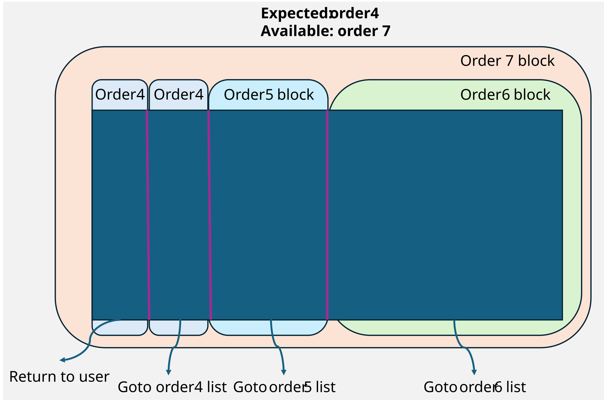

buddy allocator, 即伙伴分配器，是一种经典且高效的内存管理算法，其核心思想是通过内存块进行反复对半分裂，来满足分配的请求，并在释放的时候检查与合并相邻的伙伴块，从而有效对抗内存碎片化，其至今仍然是Linux内核物理内存管理的基石。

要理解这个分配器，我们首先要掌握几个关键术语：
-  页块(Page Block): 连续的物理页集合。伙伴分配器管理内存的基本单位不是单个页，而是页块。
-  阶(Order): 衡量页块大小的单位。`n`阶页块由$2^n$个**连续页**组成。比如，0阶是1页，1阶是2页，2    阶是4页，..., 10阶是1024页。
-  伙伴(Buddy): 两个n阶页块被称为伙伴，当且仅当他们满足如下描述的**严格的条件**:  (1) 物理地址   连续 (2) 第一个页块的物理页号是$2^n$的整数倍。这个规则确保了伙伴关系是唯一的，并且合并后    的更高阶数的区块，其地址也是对齐的。

### buddy链表

在Linux中，链表被用来管理这些块。具体来说，每一阶都对应了一条链表，链表上串着的就是这一阶的所有空闲块：
```c
struct free_area {
    struct list_head free_list;   // 该阶唯一一条空闲链表
    unsigned long nr_free;
};

struct zone {
    struct free_area free_area[MAX_ORDER];
};
```

如上面代码，`struct zone`就表示了buddy allocator接管的一块物理内存区域，这块区域按照阶数被划分，每一阶都用链表组织该阶的所有页块。`struct free_area`就表示了某一阶下的那个链表。

初看`struct free_area`， 很难看出这是一个链表，因为里面只有两个成员，而不是指针数组，或者说有`prv`, `next`成员。 其实，这是Linux内核中广泛使用的侵入式链表的设计思想。也就是说，链表节点不再是完整的数据节点，而是嵌在了数据节点内部。我们可以用两张图清晰地对比：
```C
// 非侵入式：节点自己带数据指针
struct node {
    void *data;
    struct node *next;
    struct node *prev;
};


// 侵入式：节点嵌在数据对象里
struct list_head {
    struct list_head *next, *prev;
};
struct page {
    ...
    struct list_head lru;   // 链表节点
    ...
};
struct free_area {
    struct list_head free_list;  // 链表头
    ...
};
```

因此，从文字描述出发，`struct free_area`的`free_list`成员是一个哨兵链表头，它的`prev`为`NULL`, `next`则指向了这一阶的第一个页块的第一页对应的`struct page`的`lru`成员的地址。而这个`lru`成员自身也是`struct list_head`，其`prev`就指向了哨兵头节点，即`struct free_area`的`free_list`成员，而`next`则指向了下一个页块的第一页对应的`struct page`的`lru`成员的地址，以此类推。下图就比较清楚地表示了这个关系：


### 分配过程

首先，我们可以把分配目标总结为：
-  给定一个阶数 $order$
-  目标是分配 $2^{order}$ 个连续物理页
-  返回这个物理也块的第一页的`struct page`的地址

如果对应阶的链表已经有空闲的块了，那直接返回是最方便的。如果没有的话，自然只能从更高阶的链表中去找空闲块，然后把他们分裂开，得到我们需要的阶数。因此，还可以做如下总结：
-  如果对应阶有空闲块，直接返回即可
-  如果没有，从更高阶分裂
-  分裂产生的多余块，挂回对应阶的空闲链表

整个过程的伪代码可以总结如下:
```c
page = __rmqueue_smallest(zone, order, migratetype);

static struct page *
__rmqueue_smallest(struct zone *zone, unsigned int order, int migratetype)
{
    unsigned int current_order;
    struct free_area *area;
    struct page *page;

    // 从目标阶开始，向上找第一个非空的阶
    for (current_order = order; current_order < MAX_ORDER; current_order++) {
        area = &zone->free_area[current_order];

        // 该阶该迁移类型的链表为空，继续找更高阶
        if (list_empty(&area->free_list[migratetype]))
            continue;

        // 从链表头摘下一个块
        page = list_first_entry(&area->free_list[migratetype],
                                struct page, lru);
        list_del(&page->lru);
        area->nr_free--;

        // 分裂：把大块切成目标阶
        expand(zone, page, order, current_order, migratetype);

        return page;
    }

    return NULL;   // 没有空闲块
}
```

这是一个大体的流程，我们重点要关注的是怎么从大块分裂为小块的。下面就来讲解一下。

#### expend的过程

前面我们讲到，整个buddy allocator通过侵入式链表组织，链表头节点被嵌入到了页块的第一页的`struct page`的`lru`成员中。要分裂并合并，首先就要有一个便利的方式来访问每个ppn对应的`struct page`结构体，否则便无从谈起。

为了解决这个问题，Linux实际上引入了一个`struct page`数组。在Linux中，它称作`vmemmap`.  这其实是内核虚拟地址空间中一个独立的、固定大小的区域，专门用于存放所有物理页帧的`struct page`数组。
- **在 x86_64 架构上的位置**：在典型的 4 级页表配置下，`vmemmap` 区域通常位于 `vmemmap_base` 地址，即 `0xffffea0000000000`，其大小被硬编码为 **1 TB**，以支持高达 64 TB 的系统内存。
- **在 ARM64 架构上的位置**：其虚拟地址空间的布局与 x86_64 不同，`vmemmap` 区域的起始地址和大小会有所变化，例如可能位于 `0xfffffc0000000000` 附近。

这个区域是虚拟映射的，意味着其虚拟地址连续，但是`struct page`数组所在的物理地址不必连续，并且不存在一一映射的关系。
有了这个数组后，内核态就有一个方便的方式来访问`struct page`。 下面给出了expend过程的伪代码：
```c
static void
expand(struct zone *zone, struct page *page,
       int low_order, int high_order, int migratetype)
{
    unsigned int size;
    struct free_area *area;
    struct page *right_half;

    while (high_order > low_order) {
        high_order--;
        size = 1 << high_order;

        // 右半块首页
        right_half = page + size;

        // 挂到低一阶的空闲链表
        area = &zone->free_area[high_order];
        list_add(&right_half->lru, &area->free_list[migratetype]);
        area->nr_free++;

        set_page_order(right_half, high_order);
        set_pageblock_migratetype(right_half, migratetype);
    }

    // 左半块保留，最终就是目标阶的块
    set_page_order(page, low_order);
}
```

对伪代码的解释：
-  能执行到这里，说明目标order, 即这里的low_order对应的链表没有空闲块。high_order是从         low_order一步步往上找所对应的最低的order.
-  从这个high_order中取出一个页块，每次都做对半切分，左边的保留，进入下一轮循环，右边的  则送入对应order的链表中。
-  切到最后，刚好就得到了我们需要的order的页块。

整个过程可以用下面的图来解释：


初始状态下，我们有一个order 7的大页块。我们把它对半分，得到2个order 6的大页块，右边的大页块进入对应的链表，左边的继续切分。对于左边这个，我们继续对半分，得到两个order 5的，右边送入链表，左边继续切分。一直这样下去，直到达到我们想要的order. 十分优雅。

### 释放过程

上面，我们详细解释了buddy allocator的分配过程，接下来我们来讲一讲他的释放过程。释放页块时，核心就两件事情：尝试合并，如果合并不了，就插回链表。

首先我们要明白一件事情：高order的页块的作用是比低order的大的。因为对于某个$order$，理论上他可以满足任何$request\,\,order \le order$的请求, 因为大的order可以通过分裂变为小的order。 因此，我们的核心目标是尽量合并成大的，如果做不到，再考虑把它返回到对应的链表中。

释放的时候，buddy allocator知道了以下信息：
-  释放的页块的order
-  释放的页块的首页的`struct page *`
-  首页的物理页号

#### 先尝试做合并

首先我们要明确什么情况下可以做合并。在buddy allocator中，成为伙伴的两个页块可以被合并起来，当他们满足如下关系：
-  有相同的order
-  都是空闲的
-  物理地址连续
-  低地址的那个块的首地址是 $2^{order}$ 对齐的

这个对齐约束是十分重要的。从前面的分配我们就可以看出来，从大块切成小块的过程中，每个小块的首地址天然就是 $2^{order}$ 对齐的。为了保证这一点，合并过程中，我们当然也需要保证 $2^{order}$ 的对齐。考虑下面的情况：
```
order = 2
pfn: 0 1 2 3 4 5 6 7
```

此时, `[0, 1, 2, 3], [4, 5, 6, 7]`都是合法的buddy对，因为他们的低地址块的起始地址和$2^{order}=4$对齐。但是，`[1, 2, 3, 4], [2, 3, 4, 5]`等就不是合法的，因为不对齐。

不考虑是否空闲，只考虑给定order下某个块的可能的buddy块的位置，可以用下面的式子求出：
```
buddy_pfn = pfn ^ (1 << order)
```

怎么理解这个公式呢？我们知道，buddy页块的两个首页之间的pfn由于满足对齐约束，因此只有第 $order$ 位开始的bit序列是不同的，$[0: order -1]$都是0. 或者更简单的，他们的 $order$ 位不同。因此上述异或就是去翻转 $order$ 位来快速找到自己的buddy的可能位置。

在找到候选者后，我们还需要判断他是不是真的buddy, 主要考虑以下条件：
-  是否空闲
-  是否相同阶数
-  是否跨zone
-  迁移类型相同

后两点我们可以不做了解。

通过检查后，就会执行合并，首先把buddy从其原本的空闲链表撤下来，然后合并成更高一阶的块，继续递归尝试合并，直到某一阶失败为止，然后插回链表。完整伪代码如下：
```c
__free_one_page(page, pfn, zone, order, migratetype)
{
    while (order < MAX_ORDER - 1) {
        buddy_pfn = pfn ^ (1 << order);
        buddy = pfn_to_page(buddy_pfn);

        // 检查清单
        if (page_zone(buddy) != zone)
            break;
        if (!PageBuddy(buddy))
            break;
        if (page_order(buddy) != order)
            break;
        if (get_pageblock_migratetype(buddy) != migratetype)
            break;

        // 合并
        list_del(&buddy->lru);
        zone->free_area[order].nr_free--;

        pfn = min(pfn, buddy_pfn);
        page = pfn_to_page(pfn);
        order++;
    }

    // 插回链表
    list_add(&page->lru,
             &zone->free_area[order].free_list[migratetype]);
    zone->free_area[order].nr_free++;
    set_page_order(page, order);
}
```

讲到这里，回收过程就算比较清楚了。


### 其他问题

#### 初始状态
系统初始化时，面对一大片内存，是怎么初始化那些链表的？我们前面讲到，高order的块是比低order的块有价值的。因此，在系统启动初期，会按照最高order去划分，剩余没法划分的，再降低一个order划分，直到都划分完成。

#### 非对齐请求
一般用户的请求不一定按照对齐的方式请求，比如可能请求3页，17页等等。此时，会按照向上取的方式，比如3页给4页，5页给8页等。这是buddy无法避免的代价。
