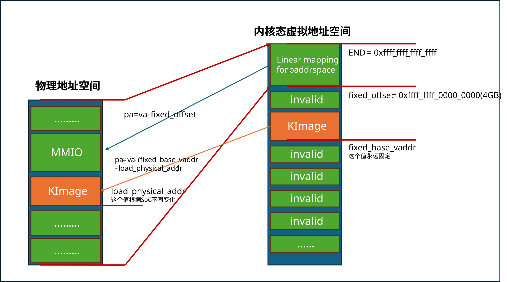

现代的操作系统内核要求对同一份内核镜像，可以加载到不同的SoC上(架构一样)。内存映射模型是由SoC方案商提供的，比如RK3588可以规定一个启动地址，QEMU virt同样可以规定另外一个不同的地址。
要适应这种不同内存映射模型的场景，就要求操作系统内核可以动态加载到不同的物理地址。因此，这一篇文章来探讨一下如何改造原本的rCore使得其适应这种需求。

### 原本的实现
在原本的实现中，我们规定了，内核的加载物理地址和内核的虚拟地址空间存在一个固定的偏移关系：
```
kernel VA = PA + fixed_offset
```

这就会带来一个问题：编译内核镜像时，我们需要提供链接脚本，规定内核的虚拟地址空间的`BASE_ADDRESS`。因此，在规定好这个基地址后，所有内核的符号都有一个固定的虚拟地址了。回到上述的偏移关系，就相当于：编译出内核镜像后，每个符号的`kernel VA`已知，而`fixed_offset`又是已知且固定的，因此就导致`PA`被迫是一个固定的值。也就是说，面对一个SoC，我们就需要为它编写专用的链接脚本，使得我们的`BASE_ADDRESS`刚好满足SoC规定的内存映射模型，这就导致了同一个`os.bin`无法适用所有SoC，效率比较低下。总结一下原本实现的顺序：
-  先搞清楚当前的board的内存映射模型，特别是搞清楚他的内核加载地址在哪里
-  编写这个board的专用链接脚本，使得内核的`BASE_ADDRESS`减去`fixed_offset`刚好等于这个SoC规定的加载地址
-  重新编译内核。这个内核只适用于所有启动地址一样的SoC。换个启动地址就无效。

这个偏移量还用在MMIO区域的访问。SoC通过设备树定义了外设的MMIO物理地址，内核则在建立页表的时候按照上述的偏移去建立PTE。

其实问题并不出在这个固定映射，而是出在它的适用场景。
在编译内核镜像时，我们需要先有链接脚本去规定一个起始的虚拟地址。因此，在编译内核镜像这件事情上，我们是先知道一个虚拟地址，去反推其物理地址; 而MMIO则是反过来，先知道物理地址，反推虚拟地址。而我们知道，变量出现在物理地址，因为不同的SoC可以规定不同的内存映射模型，因此物理地址是会发生改变的。因此，对于编译内核镜像，如果用这个映射关系，就会导致无法自适应适配; 而MMIO则没有问题，因为其在建立映射时是先知道物理地址再推出虚拟地址，而物理地址可以通过设备树实现自适应变化。

因此，改法也就很清楚：对于那些先知道物理地址的，比如MMIO，不用改;  但是对于先知道虚拟地址的，比如编译内核镜像，就不能沿用这种方式。

### 现在的实现：内核代码取指用页表
现在，对于MMIO等，我们依旧保留原本的线性映射关系。
但是，对于内核镜像的，我们现在要动态获取一个offset, 而不能复用`fixed_offset`。 具体来说，对于某一个SoC实现，其内存模型规定了内核从`load_pa`加载内核镜像，这个`load_pa`根据SoC的不同是不同的。然后，我们在编译内核镜像时，永远采用一个固定的`BASE_ADDRESS`。 总结一下：
-  不同SoC有不同的`load_pa`
-  内核镜像采用固定的`BASE_ADDRESS`

现在，我们在启动时，会动态探测这个SoC规定的加载地址`load_pa`. 然后，为内核镜像这段虚拟地址空间建立一个全新的线性映射关系：
```
pa = va - (BASE_ADDRESS - load_pa)
```

从而不同于之前的：
```
pa = va - fixed_offset
```

这样子，对于内核镜像而言，他的offset是自适应变化的，因此可以适应不同的SoC. 下图就表示了我们现在的映射方式：


如图所示，`KImage`部分根据SoC的不同，在物理地址空间中位于不同的位置。而在内核态的虚拟地址空间中，分为了两段映射，一段是整个物理地址空间的线性映射，目前的内核支持最大4GB的物理地址空间; 另一段则是KImage的专有映射，他的起始虚拟地址固定，因此不用重新编译镜像; 并且，其也采用线性映射的方式，只不过这个映射偏移根据不同的SoC动态获取。
