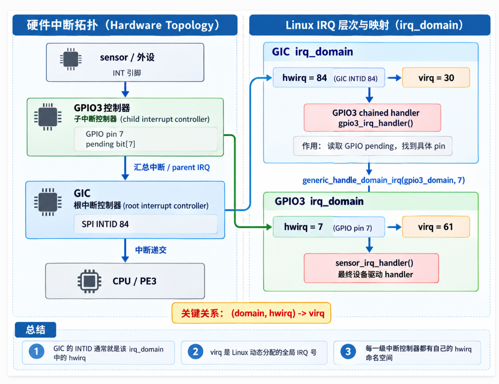

在Linux系统中，设备树作为硬件抽象的关键一环，同样在中断环节发挥至关重要的作用。在设备树中，我们就可以声明外设归属于哪个中断控制器，中断触发方式(电平or边缘)，中断是否使能等等。为了应对千千万万外设的需求，现代SoC一般都会引入一个中断控制器，用来统一管理外设的中断请求，由它来统一仲裁和处理外设的中断请求，并提交给CPU，从而避免了CPU需要引出大量引脚用来和外设连接。

通常，我们会采用层次化的方式来管理中断。普通的外设一般而言会归属到某个中断控制器名下管理，比如可以是ARM的GIC。 不过，对于简单的外设，一般是由GPIO控制器管理他们的中断，而GPIO控制器自身又是作为全局中断控制器名下的一个外设。因此，中断的管理和排布是十分层次化的。为了较好地适应这个结构，设备树和Linux内核都实现了诸多的机制。下面我们就来讲解一下Linux系统是如何管理中断的。

### irq_domain
在早期的Linux系统中，并没有这个概念，那个时候的中断号是全局静态分配的，也就是在驱动程序中静态绑定，这种做法比较简单，但是难以适应现代计算机系统庞大复杂的外设：
-  整个系统存在全局中断控制器，GPIO控制器，PCIE MSI控制器等
-  每个控制器内部，还会去管理自己名下的外设的中断资源

因此，在后面的版本中，Linux就引入了所谓的irq_domain机制。irq_domain其实就是为了建模不同的中断控制器而被开发出来的。具体来说，irq_domain引入了以下机制：
-  `hwirq`. 这个`hwirq`我们可以理解为是这个中断控制器内部的私有暗号。比如说，一个GPIO控制器有32个引脚，他可以给每个引脚的中断信号分配一个独立的`hwirq`。 这个`hwirq`是只在这个控制器内部流通的。也就是说，另外一个GPIO控制器，也同样可以分配0到31的`hwirq`。 
-  `virq`. 与`hwirq`不同，`virq`是给操作系统内核使用的，因此必须是全局唯一的。事实上，`virq`的名字就叫做全局虚拟中断号。这里的虚拟不是说虚拟化的虚拟，而是说为了方便操作系统统一管理的虚拟，重在强调不是CPU和外设的物理连线。irq_domain会提供方法，来使得其`hwirq`可以映射到某个`virq`。也就是说，`(domain, hwirq)`这个元组会唯一确定某个`virq`。 驱动接口`request_irq()`就会得到一个`virq`.
-  中断控制器内部各个中断的使能和触发方式等。

前面我们提到，`(domain, hwirq)`会映射到`virq`。 有几种常见的映射方式存在：
-  线性映射。比如说，domain 0有32个`hwirq`, 那么分配给他的`virq`就是0到31。 domain 1有40个`hwirq`, 那么他就接在domain 0的后面，得到32到71的的`virq`，以此类推。
-  树维护。前面的线性映射比较适合`hwirq`稠密分布的情况，如果`hwirq`太稀疏，就会导致`virq`被浪费，此时就可以用树维护。

通常的工作方式如下：
1. 中断控制器驱动注册 `irq_domain`，例如 `irq_domain_add_linear()` 或 `irq_domain_create_linear()`。
2. 设备树解析设备的中断属性，调用 `xlate` 得到 `hwirq` 和触发类型。
3. `irq_create_mapping()` 分配一个 `virq`，建立 `hwirq -> virq` 映射，并填充 `irq_desc`、`irq_data`。
4. 设备驱动调用 `request_irq(virq, handler)` 注册中断处理函数。
5. 中断到来时，控制器驱动拿到 `hwirq`，调用 `generic_handle_domain_irq(domain, hwirq)` 或 `irq_find_mapping()` 找到 `virq`，再分发到对应 handler。
6. 如果是级联控制器，子 domain 的父中断是父 domain 的某个 `virq`；父中断处理中再分发到子控制器的 `hwirq`。

在引入irq_domain后，整个中断的递交流程也变得层次化了，下图就很好地展现了这个层次：


根中断控制器一般就是ISA提供的那个中断控制器，这个控制器底下可以有不同的子控制器，比如GPIO控制器。外设一般就会接在其那一类的控制器底下，比如GPIO控制器。外设发起中断请求时，这个请求会先到达其父中断控制器，这里我们假设是GPIO控制器。GPIO控制器内部会看这个中断的触发方式，优先级，是否使能等，如果符合条件，其引出的、连接到其父中断控制器，也就是ISA提供的控制器的中断线会被使能。根中断控制器就会按照自己的规则，往CPU发送中断信号。对于根中断控制器而言，那些连接在GPIO控制器的外设对他来说是不可见的，他看到的，就只有GPIO控制器发出了中断信号。只不过，GPIO控制器不是去注册普通的handler,而是注册图中所示的`chained_handler`, 这个handler内部就会去看是自己的已经pending的最高优先级的`hwirq`. 而我们前面提到, `(domain, hwirq)`可以唯一地确定一个`virq`， 因此，此时就可以往内核的对应`virq`递送中断请求了。外设在编写驱动时，会调用`request_irq()`得到`virq`，然后把handler挂在这个`virq`下面。因此，由 `(domain, hwirq)`确定了`virq`后，我们最终就可以调用到外设的handler了。整个过程是十分层次化的。

### 设备树中的中断

前面我们详细讲解了操作系统中层次化的中断管理方式。这一小节，我们来讲设备树配置上是如何配合操作系统的这种管理方式的。我们以rk3588的设备树为例子讲解。

`interrupt-parent`是层次化中断中最重要的一个字段，表示这个节点由interrupt-parent所指示的中断控制器接管中断。节点下的子节点若单独声明了另外的中断控制器，则由其声明的中断控制器管理，而不再由父节点声明的中断控制器管理。比如说：
```
/ {
    interrupt-parent = <0x8007>;
    ...
    uart@febc0000 {
	    interrupts = <0x00 0x154 0x04 0x00>;
	};
};
```

表示说，在根节点下的节点中，若没有特别声明，则其中断由0x8007所代表的中断控制器管理，比如上面的uart节点。那么我们怎么知道0x8007对应哪个中断控制器呢？由`phandle`字段表示。比如下面所示的就是ISA提供的中断控制器的设备树节点：
```
gicv3: interrupt-controller@fe600000 {
    phandle = <0x8007>;

    #interrupt-cells = <0x04>;
    interrupt-controller;

    ...
    compatible = "arm,gic-v3";
};
```

可以发现，其节点下面，有`phandle= <0x8007>`, 同时，还有`#interrupt-cells`和`interrupt-controller`表明自己是一个中断控制器。需要注意的是，phandle一般是dtb自动分配的，而不是我们手写的。我们在写dts时，通常是写成这样：`interrupt-parent=<&gicv3>`, 即label引用。
`#interrupt-cells`表示属于这个中断控制器管理的中断源，需要几个`32bit cell`管理。在上面的节点中，这个值是4, 就表示，我名下的中断，需要4个`32bit cell`来完整描述这个中断的性质。而`uart@febc0000`中的`interrupts`字段就表示了那4个`32bit cell`. 在ARM的GICv3中，这4个cell的含义如下：
```
cell 0    interrupt type
cell 1    interrupt number
cell 2    flags
cell 3    PPI affinity
```

通过查阅GICv3的手册，我们可以知道`uart@febc0000`的中断字段的含义如下：
```
GIC
│
├─ type      = SPI
├─ hwirq     = 340
├─ trigger   = level-high
└─ affinity  = none
```

某些节点也可以同时是中断控制器和GPIO控制器，比如：
```
gpio3@fec40000 {
    #interrupt-cells = <0x02>;

    interrupt-controller;
    gpio-controller;

    interrupts = <0x00 0x118 0x04 0x00>;

    compatible = "rockchip,gpio-bank";
};
```

可以发现，它自己就是一个单独的中断控制器，用于管理其引脚的中断信号，其`#interrupt-cells`也和根中断控制器不同。

某些节点允许存在多个中断，比如PCIE：
```
interrupt-names = "sys", "pmc", "msg", "legacy", "err";

interrupts =
    <0x00 0x107 0x04 0x00
     0x00 0x106 0x04 0x00
     0x00 0x105 0x04 0x00
     0x00 0x104 0x04 0x00
     0x00 0x103 0x04 0x00>;
```


在没有显式声明`interrupt-parents`时，就会沿着设备树祖先寻找到第一个`interrupt-parent`,  然后继承它，比如上面的gpio3节点，他就是继承了gicv3. 因此，它本身作为gicv3的中断消费者：`interrupts = <0x00 0x118 0x04 0x00>`, 并且它自身又作为其管理的引脚的中断管理者。可以发现，gpio控制器向gicv3暴露一个中断接口，而不是每个引脚都向gicv3暴露，这就是层次化管理中断：
```
GPIO3 pin0 ─┐
GPIO3 pin1 ─┤
GPIO3 pin2 ─┤
GPIO3 pin3 ─┤
            ▼
       GPIO3 IRQ controller
            │
            │ 一根 summary IRQ
            ▼
          GIC
```

需要注意的是，设备树的父节点不一定是其`interrput-parent`，比如：
```
i2c@xxx {
    sensor@40 {
        interrupt-parent = <&gpio3>;
        interrupts = <12 IRQ_TYPE_EDGE_FALLING>;
    };
};
```

设备树结构是：
```
I2C
└── sensor
```

但是中断结构是：
```
sensor
  │
  ▼
GPIO3
  │
  ▼
GIC
```
